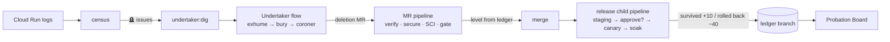

# Probation

**An AI that deletes dead code, and has to earn the right to ship it.**

GitLab Transcend "Life After Code" hackathon entry: Path A (Start Fresh), Hands-off.

- **Undertaker** is a GitLab Duo Agent Platform flow that can only delete code production telemetry proves is dead.
- **Probation** is the deterministic CI system that decides how much autonomy Undertaker has, per code zone. Autonomy is earned through deploys that survive a canary soak, and lost on rollback.

| Level | Trust score in the zone | What the pipeline lets the agent do |
|---|---|---|
| 🧑‍⚖️ Assisted | < 10 | Open an MR; a human approves and merges |
| 🟡 Supervised | ≥ 10 | Merge itself; a human approves production |
| 🟢 Hands-off | ≥ 30 | Issue → merge → canary → production, no human |

A rollback costs 40 points: instant demotion. Thresholds are demo-accelerated, in [`probation/policy.yml`](probation/policy.yml).

**Live links:** ✏️ Tallybook on Cloud Run · ✏️ Probation Board (Pages) · ✏️ Demo video

## How it works



All nine DevSecOps stages are covered: plan, create, verify, secure, package, release, configure, monitor and govern. See [`docs/SUBMISSION.md`](docs/SUBMISSION.md) for the per-stage table.

## The app

`app/` is **Tallybook**, a small invoicing app (Fastify on Node 22) written for this hackathon. Its legacy debt is **simulated on purpose** so there is something real to bury:
- `/api/v1/*` and `/api/fax-invoice`;
- stale flags;
- the unused `moment` and `lodash` packages;
- an orphan export.

## Run it

```bash
npm run setup          # Node ≥ 22.18
npm run check          # lint + typecheck + 40 tests
npm run dev            # Tallybook on http://localhost:8080
npm run demo:mock      # the whole Probation story offline → .out/board.html
```

To deploy it on GitLab and Google Cloud, follow [`docs/RUNBOOK.md`](docs/RUNBOOK.md).

## Repository map

| Path | What |
|---|---|
| `flows/undertaker.yml` | The Duo flow (AI Catalog item) |
| `probation/policy.yml` | Zones, thresholds, scoring (CODEOWNERS-protected) |
| `probation/src/` | Gate, ledger, census, SCI, board (pure and tested) plus `cli/` CI entry points |
| `.gitlab-ci.yml` | MR, main, release-child and schedule pipelines |
| `ci/`, `infra/` | Cloud Run deploy, canary, rollback; one-time GCP bootstrap (keyless WIF) |
| `docs/build/` | PRD, architecture, roadmap and guardrails (agent-ready build docs) |
| `docs/SCI.md` | Carbon measurement method |

## License

MIT. See [LICENSE](LICENSE).
