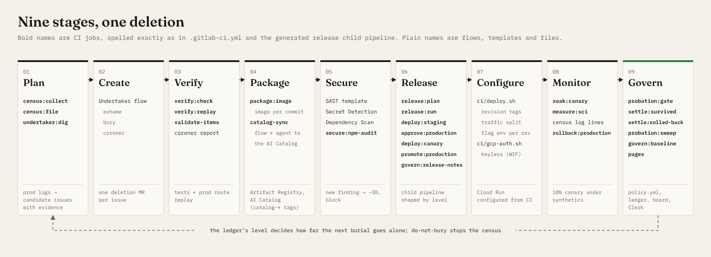

# Probation

> ✏️ **Working title.** Pick the final project name yourself before submitting (the hackathon FAQ asks for a human-chosen name), then replace "Probation" here, in `docs/SUBMISSION.md` and in the video cards.

**An AI that deletes dead code, and has to earn the right to ship it.**

GitLab Transcend "Life After Code" hackathon entry · Path A (Start Fresh) · Category: Hands-off · Special prizes: Most Stages Covered, Most Environmentally Impactful.

- **Undertaker** is a GitLab Duo Agent Platform flow that can only *delete*, and only code that production telemetry proves is dead.
- **Probation** is the deterministic CI system that decides how much autonomy Undertaker has, per code zone. Autonomy is earned through deploys that survive a production canary soak, and lost on rollback.

**The twist:** autonomy is not a setting. The agent earns it in production, zone by zone, and loses it the moment it breaks something.

👩‍⚖️ **Judging?** Start with [`docs/JUDGES.md`](docs/JUDGES.md): a 2-minute path through the demo, the evidence and how to verify each claim.

| Level | Trust score in the zone | What the pipeline lets the agent do |
|---|---|---|
| 🧑‍⚖️ **Assisted** | < 10 | Open an MR. A human merges it and approves production. |
| 🟡 **Supervised** | ≥ 10 | The gate sets auto-merge. A human clicks `approve:production`. |
| 🟢 **Hands-off** | ≥ 30 | Issue → MR → merge → 10% canary → production, with no human. |

A surviving soak earns +10; a rollback costs −40 (instant demotion), a human rejection −20 and a new security finding −30. An MR that touches several zones gets the level of its least-trusted zone. Thresholds are demo-accelerated and live in [`probation/policy.yml`](probation/policy.yml), which only humans may change (CODEOWNERS).

## ▶ Watch it

| | |
|---|---|
| 🎬 Demo video (under 3 min) | ✏️ YouTube link |
| 🪦 Probation Board (live ledger) | ✏️ GitLab Pages URL |
| 🧾 Tallybook on Cloud Run | ✏️ `https://tallybook-….run.app` |
| 📄 Devpost page | ✏️ link |
| 📼 Ledger replay (30 s, offline story) | [`docs/media/replay.webm`](docs/media/replay.webm) · live as `replay.html` next to the board |
| 🎛️ Gate playground | `playground.html` next to the board: move the scores and watch the real gate decide ([screenshot](docs/media/playground.png)) |
| 🎞️ Fallback video (offline rehearsal) | [`docs/media/demo-rough-cut.mp4`](docs/media/demo-rough-cut.mp4), 2:50 with captions in [`docs/media/demo-rough-cut.srt`](docs/media/demo-rough-cut.srt) |

> **Honest status.** The CI pipeline, the gate, the ledger, the census, SCI measurement, the board, a real Docker build of Tallybook and the schema-validated flow and agent are built, with 170+ tests including an end-to-end suite of the real CLIs against a local GitLab API simulator (`probation/sim/`). The live Google Cloud deploy and the live Duo flow runs have **not** been executed yet: until they are, the Pages board shows an "Offline rehearsal" banner over the scripted ledger from `npm run demo:mock`, and the fallback video is labelled offline rehearsal.


<sub>Source: [`docs/media/diagrams/architecture.svg`](docs/media/diagrams/architecture.svg)</sub>

## How it works

1. **Census (plan).** A nightly scheduled pipeline reads Tallybook's per-request log lines from Cloud Logging (`census:collect`). `census:file` opens one 🪦 issue for every route with zero traffic in the window, flag that never changed, unused dependency and orphan export. Each issue carries its evidence and a `zone::` label.
2. **Undertaker digs (create).** `undertaker:dig` starts the Undertaker flow on one candidate through the Flows API. The flow has three agent steps: **exhume** reads the issue and the code, **bury** opens one minimal deletion MR with an epitaph and the evidence, and **coroner** reviews its own MR adversarially and flags any live reference with `coroner::objection`. It has no clone and no merge rights.
3. **The gate decides (verify · secure · govern).** The MR pipeline runs lint, typecheck and tests, replays every production route (`verify:replay`), runs SAST, Secret Detection and Dependency Scanning, measures SCI, and finally runs `probation:gate`. The gate reads `policy.yml` and the ledger and returns *block*, *needs a human*, *merge (Supervised)* or *merge (Hands-off)*. It is plain TypeScript with no LLM.
4. **Release on probation (package · release · configure · monitor).** After merge, `release:plan` generates a child pipeline shaped by the verdict: `deploy:staging` (new Cloud Run revision, 0% traffic) → `approve:production` (manual unless Hands-off) → `deploy:canary` (10% of real traffic) → the soak → `promote:production`. The soak has two independent checks: `soak:canary` runs synthetic clients against the canary for 3 minutes, and `soak:canary-signal` reads the canary's real requests from Cloud Logging (collected by `soak:canary-logs`) and fails on a 5xx rate or on hits to deleted routes beyond the previous revision's baseline. If a synthetic fails, `rollback:soak` takes traffic off the canary at once; if anything fails, `rollback:production` puts traffic back on the previous revision.
5. **Settle (govern).** `settle:survived` scores +10 per zone. `settle:rolled-back` scores −40, reverts the commit and marks the candidate `undertaker::do-not-bury` forever. Every change is appended to the `ledger` branch, opens a 🎖️ promotion or ⬇️ demotion issue when a level changes, and is published on the **Probation Board** (GitLab Pages), with an animated ledger replay (`replay.html`) next to it. The **Probation Clerk**, a read-only custom Duo agent, answers "why is this zone Assisted?" in Duo Chat from `policy.yml` and the ledger; the probation MCP server gives Duo Agentic Chat in the IDE the same answers.

**In the demo,** Undertaker climbs from Assisted to Hands-off in the legacy zone, then buries `GET /api/v1/export.csv`: zero hits in seven days. But a bookkeeping partner calls it once a month. The canary soak catches the 404, traffic rolls back, the commit is reverted, the grave is marked do-not-bury, and Undertaker drops straight to Assisted, with no human in the loop. Autonomy you can earn, and lose.

**Why a platform team would use it:** it turns "do we trust the agent?" into a reviewed policy file, a per-zone score anyone can query and an append-only audit trail, so autonomy can be granted gradually instead of all or nothing.

## All nine DevSecOps stages



| Stage | Where it happens |
|---|---|
| Plan | `census:collect`, `census:file`, `undertaker:dig`: production logs become labelled candidate issues |
| Create | The Undertaker flow ([`flows/undertaker.yml`](flows/undertaker.yml)): exhume → bury → coroner |
| Verify | `verify:check` (lint, typecheck, tests), `verify:replay` (production routes must still answer) |
| Package | `package:image`: Cloud Build → Artifact Registry, one image per commit; the flow as an AI Catalog item |
| Secure | SAST, Secret Detection and Dependency Scanning templates; `secure:npm-audit`; new findings block the MR and cost −30 |
| Release | `release:plan` → `release:run` child pipeline → `deploy:staging` → `approve:production` → `deploy:canary` → `promote:production`; `govern:release-notes` |
| Configure | [`ci/deploy.sh`](ci/deploy.sh): revision tags, traffic splits, flag env per revision; keyless WIF auth; `policy.yml`; `npm run gitlab:setup` (labels, schedule, protected tag, MR settings) |
| Monitor | Per-request census logs; `soak:canary` synthetics; `soak:canary-logs` → `soak:canary-signal` (the canary's real 5xx rate and deleted-route hits); `rollback:soak`, `rollback:production`; `measure:sci` |
| Govern | `probation:gate`, `settle:*`, `probation:sweep`, `govern:baseline`, `pages`; CODEOWNERS; `audit.jsonl`; Probation Clerk |

The per-job evidence (what to look at and what to screenshot) is in [`docs/STAGES.md`](docs/STAGES.md).

## Sustainability

Every MR and main pipeline measures Tallybook with the Green Software Foundation's **Software Carbon Intensity** spec (ISO/IEC 21031:2024): **SCI = (E·I + M) per 1,000 requests**.
- **E** is measured, not estimated from a table: CPU time and RSS under a fixed load mix, cold-start time and deployable size, converted with Cloud Carbon Footprint coefficients.
- **I** is 432 gCO₂e/kWh, Google's 2025 location-based figure for `us-central1`.
- **M** is embodied emissions per vCPU-hour.

`measure:sci` posts a 🌱 before/after note on each MR, and the board tracks the change since the first measurement. Deleting dead code mostly shrinks the image and the cold start, not the per-request CPU, and the note says so. ✏️ Measured result from the dependency burial: SCI −X% (copy from that MR's 🌱 note). Method, coefficients and limits: [`docs/SCI.md`](docs/SCI.md).

## Run it locally

```bash
npm run setup          # Node ≥ 22.18; installs the root and app/ dependencies
npm run check          # Biome lint + tsc typecheck + the Vitest suite
npm run dev            # Tallybook on http://localhost:8080
npm run demo:mock      # the whole story offline → .out/board.html, replay.html and playground.html
```

`npm run demo:mock` needs no GitLab, Google Cloud or Duo credits: it plays the five acts (climb, fall, recovery) through the real gate and ledger code with scripted production outcomes, then renders the board, the replay and the gate playground. The CLIs are also tested end to end against a local GitLab simulator (`probation/sim/`, `probation/test/e2e/`). To deploy for real on GitLab and Google Cloud, follow [`docs/RUNBOOK.md`](docs/RUNBOOK.md): `npm run gitlab:setup` creates the labels, schedule, protected tag and MR settings, `npm run doctor` is a read-only preflight before spending credits, `npm run demo` drives each act of the live demo from the terminal, and `npm run submission` fills the marked placeholders in these docs from the live ledger once the runs exist.

## The app

`app/` is **Tallybook**, a small invoicing app (Fastify on Node 22) written for this hackathon. Its legacy debt is **simulated on purpose**, so there is something real to bury:
- the `/api/v1/*` routes and `/api/fax-invoice`;
- stale feature flags;
- the unused `moment` and `lodash` packages;
- an orphan export.

## Repository map

| Path | What |
|---|---|
| [`flows/undertaker.yml`](flows/undertaker.yml) | The Undertaker Duo flow (AI Catalog item) |
| [`agents/probation-clerk.yml`](agents/probation-clerk.yml) | The Probation Clerk: a read-only custom Duo agent (AI Catalog item) |
| [`mcp/`](mcp/) | Read-only probation MCP server (`get_trust`, `list_graves`, `explain_gate`, `policy`), wired in `.gitlab/duo/mcp.json` |
| [`probation/policy.yml`](probation/policy.yml) | Zones, thresholds, scoring, soak and census settings (CODEOWNERS-protected) |
| [`probation/synthetics.yml`](probation/synthetics.yml) | The clients the soak checks, including the monthly partner export |
| [`probation/src/`](probation/src/) | Gate, ledger, census, SCI, board, replay and gate playground (pure, tested) plus `cli/` CI entry points |
| `probation/sim/`, `probation/test/e2e/` | Local GitLab simulator and end-to-end tests of the CI entry points |
| [`.gitlab-ci.yml`](.gitlab-ci.yml) | MR, main, release-child and schedule pipelines |
| [`scripts/`](scripts/) | GitLab setup and preflight, the live-demo driver, the offline mock story, media rendering, `check-docs.ts` (keeps these docs true to the code) |
| [`ci/`](ci/), [`infra/`](infra/) | Cloud Run deploy, canary and rollback; one-time GCP bootstrap (keyless WIF) |
| [`app/`](app/) | Tallybook, the app being cleaned |
| [`docs/JUDGES.md`](docs/JUDGES.md) | The 2-minute judging path |
| [`docs/STAGES.md`](docs/STAGES.md) | The nine stages, job by job |
| [`docs/SCI.md`](docs/SCI.md) | Carbon measurement method |
| [`docs/RUNBOOK.md`](docs/RUNBOOK.md) | Deploy to GitLab and Google Cloud |
| [`docs/build/`](docs/build/) | PRD, architecture, roadmap and guardrails (agent-ready build docs) |

## License

MIT. See [LICENSE](LICENSE).
