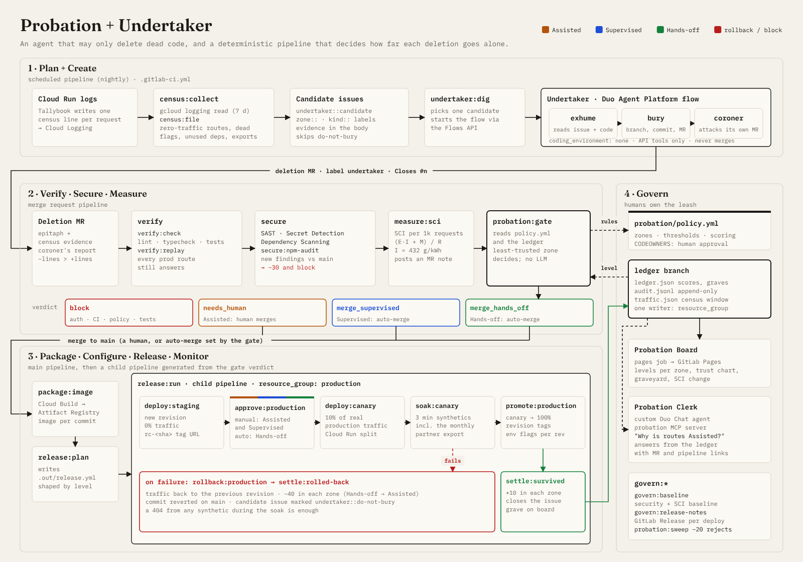

# Devpost submission draft

> Replace every line marked ✏️ before you submit. Pick the final name yourself (the FAQ asks for a human-chosen name, not an AI-chosen one). "Probation" is a working title. Numbers in this file are only ones the code or a cited source gives; every measured result is a ✏️ until you copy it from a real pipeline.

**Name:** Probation ✏️
**Tagline:** An AI that deletes dead code, and has to earn the right to ship it.
**Path:** A: Start Fresh · **Category:** Hands-off · **Special prizes:** Most Stages Covered, Most Environmentally Impactful
**Links:**
- ✏️ GitLab repo
- ✏️ Tallybook on Cloud Run
- ✏️ Probation Board (GitLab Pages)
- ✏️ YouTube video (under 3 minutes)
- ✏️ Ledger replay (`replay.html` on the Pages site; a 30-second recording is in `docs/media/replay.webm`)

## What it does

Code generation is solved; code *deletion* isn't. Nobody lets an agent remove code, because "dead" code sometimes has one caller a month. And nobody lets an agent ship to production alone, because autonomy today is a setting you pick and hope.

We built both halves of the answer on GitLab:

**Undertaker** is a GitLab Duo Agent Platform flow that can only delete, and only what production proves is dead.
- Every night a **census** reads Tallybook's Cloud Run request logs and files a 🪦 issue for each route with zero traffic in the window, each flag that never changed, each unused dependency and each orphan export. Each issue carries its evidence (request counts, window, zone).
- Undertaker **exhumes** (reads the issue and the code), **buries** (one minimal deletion MR with an epitaph, the evidence and `Closes #n`), then acts as its own **coroner**: it searches for live references to everything it removed and labels the MR `coroner::objection` if it finds one.

**Probation** is a deterministic CI system that decides how far each of Undertaker's MRs goes alone.
- Trust is earned **per code zone** (legacy, flags, deps, routes, core), from deploys that survive a 10% production canary soak (+10), and lost on rollback (−40), human rejection (−20) or a new security finding (−30).
- **Assisted** (score < 10: a human merges) → **Supervised** (≥ 10: auto-merge, a human approves production) → **Hands-off** (≥ 30: from issue to production with no human). An MR spanning zones gets the level of its least-trusted zone.
- The agent can't merge, can't touch auth, CI or its own policy, can't add code and can't add or edit tests. The gate enforces all of it in TypeScript, not in a prompt, and `policy.yml` is protected by CODEOWNERS.
- A **Probation Clerk** custom Duo agent (an AI Catalog item) answers "why is the routes zone still Assisted?" in Duo Chat by reading `policy.yml` and the ledger branch, citing the MRs behind each score. It is read-only. A probation MCP server exposes the same answers (`get_trust`, `list_graves`, `explain_gate`, `policy`) to Duo Agentic Chat in the IDE.

**In the demo, Undertaker climbs from Assisted to Hands-off, then breaks a monthly partner export.** It buries `GET /api/v1/export.csv` (zero hits in seven days). The bookkeeping partner calls it on the 1st of each month. During the canary soak, that partner's synthetic check returns 404 (and the canary's own request logs show the hit on a deleted route). Traffic rolls back, the commit is reverted, Undertaker drops to Assisted, and the grave is marked do-not-bury forever. Autonomy you can earn, and lose.

## How we built it



- **The agent proposes; the pipeline disposes.** Undertaker is a custom flow (`flows/undertaker.yml`, three `AgentComponent`s, `coding_environment: none`, GitLab API tools only). It is started by a scheduled CI job through the Flows API, and published to the AI Catalog by the `catalog-sync` CI component.
- **The gate is code.** `probation/src/gate.ts` is a pure function of the policy, the ledger and the MR diff. It returns one of four verdicts, posts a note that cites the rule file, labels the MR `probation::<level>` and `zone::<zones>`, and sets auto-merge when the level allows it.
- **The release pipeline is generated.** On main, `release:plan` writes a child pipeline whose shape depends on the verdict: at Supervised it contains a manual `approve:production`; at Hands-off it doesn't. Cloud Run revision tags and traffic splits give staging (0% traffic), canary (10%) and rollback without a second service.
- **The ledger is a branch.** `ledger.json`, an append-only `audit.jsonl` and `traffic.json` live on a `ledger` branch. Every writer takes `resource_group: ledger`. The Probation Board on GitLab Pages, the Probation Clerk agent and the MCP server all read from it.
- **The census is honest about its blind spot.** A 7-day window can't see a monthly client, so `probation/synthetics.yml` lists known long-period clients and the soak hits the canary with them. In parallel, `soak:canary-logs` reads the canary revision's real requests from Cloud Logging and `soak:canary-signal` fails the soak on a 5xx rate or on hits to deleted routes above the previous revision's baseline. A failed synthetic triggers `rollback:soak` at once. A rollback becomes a learning signal: the candidate is labelled `undertaker::do-not-bury` and the census skips it.
- **Tested without the cloud.** The gate, ledger, census, SCI, board and replay are pure modules with Vitest tests. A local GitLab simulator runs the CI entry points end to end, and `npm run demo:mock` plays the five acts offline. A docs check in the test suite fails CI if this text names a job, file, script or threshold the code doesn't have.
- **Set up and rehearsed from the terminal.** `npm run gitlab:setup` creates the labels, schedule, protected tag and MR settings idempotently; `npm run doctor` is a read-only preflight before any credits are spent; `npm run demo` drives each live act.

### All nine DevSecOps stages


| Stage | Exact jobs | What runs |
|---|---|---|
| Plan | `census:collect`, `census:file`, `undertaker:dig` | Production logs become labelled candidate issues (zone, kind, evidence); one is picked and the flow started |
| Create | Undertaker flow: `exhume` → `bury` → `coroner` | A minimal deletion MR with evidence, then an adversarial review of it |
| Verify | `verify:check`, `verify:replay`, `validate-items` | Lint, typecheck and tests, plus a **traffic replay**: every route that served production traffic must still answer. Catalog YAML is schema-checked. |
| Package | `package:image`, `catalog-sync` | Cloud Build → Artifact Registry image per commit; the flow and the Clerk agent published to the AI Catalog on `catalog-*` tags |
| Secure | SAST, Secret Detection and Dependency Scanning templates; `secure:npm-audit` | Findings diffed against main's baseline by the gate. A new finding blocks the MR and costs −30. Auth and CI paths are forbidden zones. |
| Release | `release:plan`, `release:run` → `deploy:staging` → `approve:production` → `deploy:canary` → `promote:production`; `govern:release-notes` | A child pipeline shaped by the earned level; a GitLab Release per deploy |
| Configure | `ci/deploy.sh`, `ci/gcp-auth.sh`, `probation/policy.yml`, `npm run gitlab:setup` | Cloud Run revision tags, traffic splits, flag env vars per revision and Secret Manager, all from CI; keyless GitLab → GCP auth (Workload Identity Federation); autonomy itself as reviewed config; project labels, schedule and protected tag created by script |
| Monitor | `soak:canary`, `soak:canary-logs`, `soak:canary-signal`, `rollback:soak`, `rollback:production`, `measure:sci` | Structured per-request census logs in Cloud Logging; synthetic clients against the canary for 3 minutes; the canary's real 5xx rate and deleted-route hits versus the previous revision; automatic rollback; SCI per MR |
| Govern | `probation:gate`, `settle:survived`, `settle:rolled-back`, `probation:sweep`, `govern:baseline`, `pages` | `policy.yml` + CODEOWNERS (humans own the leash); append-only ledger; 🎖️ promotion and ⬇️ demotion issues; the Probation Board and its ledger replay; the Probation Clerk agent and MCP server |

Per-job evidence and screenshots: `docs/STAGES.md`.

**Stack:** TypeScript on Node 22 (native type stripping, no build step), Fastify, Vitest, Biome, GitLab CI (dynamic child pipelines, resource groups, CI components, security templates, Pages, Releases), GitLab Duo Agent Platform (custom flow, custom agent, Flows API, AI Catalog, MCP), Cloud Run, Cloud Build, Artifact Registry, Cloud Logging, Secret Manager.

## Environmental impact (Most Environmentally Impactful)

Every MR and main pipeline measures Tallybook with the Green Software Foundation's **Software Carbon Intensity** specification (ISO/IEC 21031:2024):

```text
SCI = ((E × I) + M) per R        R = 1,000 HTTP requests served
```

**What is measured on every pipeline (`measure:sci`, `probation/src/cli/sci.ts`):**
- cold start: spawn → healthy;
- CPU time (`utime + stime` from `/proc`) and sampled RSS while autocannon drives a fixed request mix (10 connections, 10 s);
- deployable size: `app/src` plus production `node_modules`.

**How it becomes carbon** (coefficients in `probation/sci-coefficients.yml`, all checked against the Cloud Carbon Footprint methodology on 2026-10-26):
- **E** = compute (CPU-hours × 4.26 W per vCPU) + memory (GB-hours × 0.000392 kWh) + image transfer (GB × 0.001 kWh × 1 cold start per 1k requests) + cold start (seconds × 4.26 W), all × PUE 1.1.
- **I** = **432 gCO₂e/kWh**, the location-based grid intensity of `us-central1` (Iowa) in Google's 2025 region data (431.95 unrounded, 88% CFE).
- **M** = 0.713 g per vCPU-hour of reserved time (1,200 kgCO₂e host embodied emissions over 4 years and 48 vCPUs; the host figures are our stated assumptions).

**What we report, honestly:** deleting dead code barely moves per-request CPU. It shrinks the image every cold start pulls and the module loading at boot. The 🌱 MR note shows each component, main vs MR, so the saving is visible where it is real. In the built container, `moment` and `lodash` are 5.9 MB of the 16.0 MB of production `node_modules` (37%); the deployable size `measure:sci` counts (`du -sk app`) drops from 25.9 to 15.7 MB without them (measured locally on 2026-10-27).

**Measured results:**
- ✏️ Dependency burial (moment + lodash): app layer ✏️ X MB → ✏️ Y MB, cold start ✏️ a ms → ✏️ b ms, SCI ✏️ −X% (copy from that MR's 🌱 note).
- ✏️ All burials since the first measurement: SCI ✏️ −X% (board stat "SCI change").
- ✏️ Optional scale-up: at ✏️ N requests a month, that is ✏️ g CO₂e a year (show the arithmetic).

**Design choices for low energy:**
- The flow uses `coding_environment: none`: no repo clone, no runner, API tools only.
- One small candidate per run.
- Cloud Run scales to zero on 256 MiB instances.
- No build step and no build artifacts: Node runs the TypeScript directly.
- Tag pipelines run only `catalog-sync`; release tags never build.
- The release image is `node:22.23-slim` plus production dependencies only, running as the unprivileged `node` user.

Method and limits (CPU watts are an estimate, results are comparative, CI minutes not counted): `docs/SCI.md`.

## Challenges we ran into

- **Agents can't merge, and pipeline triggers ignore bots.** That pushed us to the better design: the *pipeline* holds the power, and the agent only proposes. The Flows API has to be called with a person's token, so only the scheduled job on `main` uses it.
- **The flow schema is stricter than the runtime.** The AI Catalog validates flows against the registry v1 schema, which rejects `max_cycles` even though the runtime accepts it. We kept the flow schema-valid and capped work by design: one candidate per run.
- **A census can't see clients slower than its window.** Rather than pretend otherwise, we made the canary soak the backstop and turned the rollback into a learning signal (do-not-bury and demotion).
- **Concurrent pipelines and one ledger.** Two settle jobs writing the same JSON would lose an event. Every ledger writer shares `resource_group: ledger`, and only one release child pipeline runs at a time (`resource_group: production`).
- **Measuring carbon without a power meter.** We measure what a CI runner can measure (CPU time, RSS, size, cold start), use published coefficients, and say where the estimate is weak.

## Accomplishments we're proud of

- An agent whose autonomy is a number in a file, earned in production and visible to everyone.
- A rollback that teaches: one failed soak demotes the agent, reverts the change and makes sure that grave is never dug again.
- All nine stages covered by jobs that do real work, not placeholders.

## What we learned

- Trust in an agent is a per-area, per-history property, not a global toggle. Zones made the levels believable.
- The most useful thing an LLM step did was attack its own output. The coroner is cheap and catches what exhume missed.
- Deterministic code is the right place for permission decisions. The LLM never decides what merges or ships.
- Carbon claims are only worth making when they are specific; most of a deletion's saving is size and cold start, not CPU.

## What's next

- Several agents on probation side by side (a test-writer next to Undertaker), each with its own ledger.
- Latency signals in the soak, next to the synthetics and the canary's error rate.
- Org-wide trust that transfers between projects with similar zones.
- Real-world thresholds (about 10× the demo's soak and scores).

## Image gallery

Upload in this order (all PNG, 16:9 or wider where possible):
1. `docs/media/cards/png/01-hook.png`: title card.
2. `docs/media/diagrams/architecture.png`: the whole system.
3. `docs/media/cards/png/02-ladder.png`: the autonomy ladder.
4. `docs/media/board-light.png`: the Probation Board after the five acts.
5. `docs/media/cards/png/03-rollback.png`: the demotion.
6. `docs/media/diagrams/stages.png`: the nine stages with their job names.
7. `docs/media/cards/png/04-stages.png`: stages card from the video.
8. `docs/media/board-dark-mobile.png`: the board on a phone, dark mode.
9. `docs/media/cards/png/05-end.png`: closing card.
10. `docs/media/replay-frames/03.png`: the ledger replay at the rollback.
11. ✏️ Screenshots from the live project: the gate note at Hands-off, the `soak:canary` 404 log, Cloud Run revisions with traffic split, a 🌱 SCI note.

## Built with

gitlab, gitlab-ci, gitlab-duo-agent-platform, gitlab-ai-catalog, gitlab-pages, mcp, google-cloud-run, cloud-build, artifact-registry, cloud-logging, secret-manager, typescript, node.js, fastify, vitest, biome
