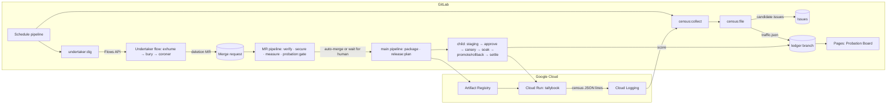
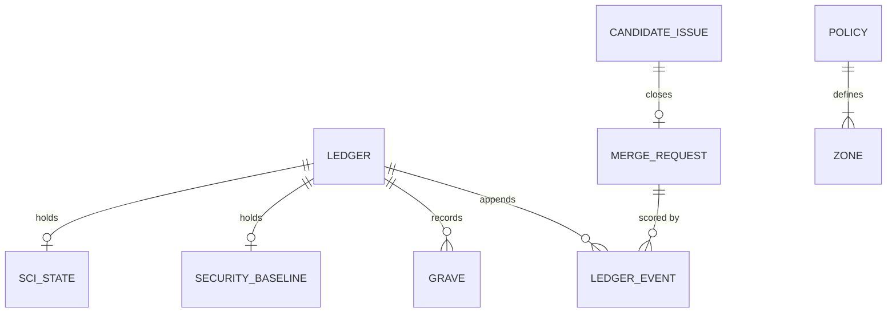
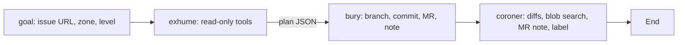

# Probation + Undertaker — Architecture

> Version: 1.0 · Updated: 2026-10-26 · Source of truth for stack, contracts, data and deployment.

## 1. System Overview

There are three parts:
- **Tallybook,** the app that gets cleaned, on Cloud Run.
- **Undertaker,** a Duo flow that proposes deletions.
- **Probation,** TypeScript CLIs that run in GitLab CI and decide, release, score and publish.

The agent never holds merge or deploy power. Every irreversible action is taken by a deterministic CI job reading `probation/policy.yml` and the ledger.

## 2. Tech Stack

| Layer | Choice | Rationale |
|---|---|---|
| Runtime | Node.js 22.18+ (native TypeScript type stripping) | No build step: the same `.ts` runs in tests, CI and the container |
| Language | TypeScript 5.9 (`strict`, `erasableSyntaxOnly`) | Type safety without transpile-only syntax |
| App framework | Fastify 5.6 | Route templates in `routeOptions.url` make census lines exact |
| CLI libraries | `yaml` 2.8, `picomatch` 4.0, `autocannon` 8.0 | Policy parsing, zone globs, the SCI load mix |
| Tests | Vitest 3.2 | Fast, native ESM and TypeScript |
| Lint and format | Biome 2.2 | One tool, zero config sprawl |
| Agent platform | GitLab Duo Agent Platform custom flow (registry v1), AI Catalog | Required by the hackathon; flows run in GitLab with composite identity |
| CI/CD | GitLab CI with a dynamic child pipeline for release; templates for SAST, Secret Detection and Dependency Scanning | Release shape depends on the gate's verdict |
| Hosting | Cloud Run (us-central1), Artifact Registry, Cloud Build, Cloud Logging, Secret Manager | Revision tags and traffic splits give canary and rollback for free; +0.2 bonus |
| GCP auth | Workload Identity Federation with a GitLab OIDC `id_tokens` (SA key fallback) | No long-lived keys in CI |
| Board | Static HTML from `probation/src/board.ts` on GitLab Pages | Zero runtime, versioned with the ledger |

## 3. Component Boundaries

| Component | Path | Owns | Must not |
|---|---|---|---|
| Tallybook | `app/src` | Invoice API and UI, flags, one census line per request | Know about Probation |
| Policy | `probation/policy.yml`, `probation/src/policy.ts` | Zones, thresholds, scoring, soak and census settings | Be edited by the agent (forbidden zone and CODEOWNERS) |
| Gate | `probation/src/gate.ts` (pure), `cli/gate.ts` | Verdict per MR | Call an LLM |
| Ledger | `probation/src/ledger.ts` (pure), `store.ts` | Scores, events, graveyard, security and SCI baselines | Rewrite history (append-only `audit.jsonl`) |
| Census | `probation/src/census.ts`, `cli/census.ts` | Candidate detection, issues, `traffic.json` | Propose `policy.census.keep` routes or do-not-bury keys |
| Release | `cli/release-plan.ts`, `ci/deploy.sh`, `cli/soak.ts`, `cli/settle.ts` | Child pipeline, canary, soak, rollback, scoring | Promote without a soak |
| SCI | `probation/src/sci.ts`, `cli/sci.ts`, `sci-coefficients.yml` | Carbon measurement | Use undocumented coefficients |
| Board | `probation/src/board.ts`, `cli/board.ts` | Public view | Read anything but the ledger and policy |
| Undertaker | `flows/undertaker.yml` (AI Catalog) | Investigation, the deletion MR, self-review | Merge, deploy, or touch forbidden zones |
| GitLab client | `probation/src/gitlab.ts` | REST calls with retry on 429/5xx | Be used outside CLIs |

## 4. Data Model

There is no database. State lives in git (the `ledger` branch), GitLab issues and MRs, and Cloud Logging.

**Ledger** (`ledger.json` on branch `ledger`)

| Field | Type | Notes |
|---|---|---|
| version | `1` | Schema version |
| scores | `Record<agent, Record<zone, number>>` | ≥ 0; missing means 0 |
| events | `LedgerEvent[]` | Append-only; mirrored line by line in `audit.jsonl` |
| graveyard | `Grave[]` | One per settled release |
| security | `SecurityBaseline?` | Fingerprints from main after the last release |
| sci | `{ baseline?: SciResult, history: SciPoint[] }` | Baseline is replaced after each surviving release |

**LedgerEvent:** `at` ISO string · `agent` · `zone` · `event` (`survived_soak | rolled_back | human_rejected | security_finding`) · `points` · `scoreAfter` · `levelBefore` / `levelAfter` (`assisted | supervised | hands_off`) · `ref {mr?, sha?, pipeline?, url?}` · `note?`.

**Grave:** `at` · `mr?` · `title` · `zone` (joined with `+`) · `linesRemoved` · `sciDeltaPct?` · `status` (`buried | exhumed`).

**SciResult:** `gramsPer1kRequests` · `kwhPer1kRequests` · `breakdown {computeG, memoryG, networkG, coldStartG, embodiedG}` · `measurement {requests, cpuSeconds, avgRssMb, durationSeconds, deployableMb, coldStartMs}` · `region`.

**Zone** (policy): `name` · `globs[]` · `forbidden?` · `neutral?`. The first match wins. Zones in order: auth (forbidden), probation (forbidden), tests (neutral), legacy, flags, deps, routes, core.

**CensusLine** (Cloud Logging `jsonPayload`): `{census:1, method, route (template or "unmatched"), status, flags: {name: boolean}}`.

**Candidate issue:**
- Title `🪦 <title>`.
- Body starts with `<!-- undertaker:key=<kind>:<id> -->`.
- Labels `zone::<z>`, `kind::<route|flag|dependency|export>` and exactly one scoped lifecycle label: `undertaker::candidate`, `undertaker::in-progress`, `undertaker::buried` or `undertaker::do-not-bury` (adding one replaces the others).

**MR labels written by the gate:** `probation::<level>` and `zone::<z1+z2>`. `release-plan` reads them back on main.

**Migrations:** bump `Ledger.version` and add a reader that upgrades the old shape. Never rewrite `audit.jsonl`.

## 5. API Specification

### 5.1 Tallybook HTTP API (F-08)

Conventions:
- JSON, no versioned prefix (`/api/v1/*` is the legacy surface being buried).
- Writes need the `x-api-key` header (Secret Manager `tallybook-api-key`).
- Errors use `{ "error": { "code": "not_found", "message": "Invoice not found" } }`.

| Method | Path | Auth | Request | Response | Codes | Feature |
|---|---|---|---|---|---|---|
| GET | `/` | none | — | HTML dashboard | 200 | F-08 |
| GET | `/healthz` | none | — | `{ok, revision}` | 200 | F-05, F-06 |
| GET | `/api/invoices` | none | — | `{invoices: Invoice[], outstanding: Record<currency, cents>}` | 200 | F-08 |
| GET | `/api/invoices/:id` | none | — | `Invoice` | 200, 404 | F-08 |
| POST | `/api/invoices` | api key | `{customer 1–120 chars, amountCents 1–1e8, currency USD/EUR/GBP}` | `Invoice` | 201, 400, 401 | F-08 |
| POST | `/api/invoices/:id/pay` | api key | — | `Invoice` | 200, 401, 404 | F-08 |
| GET | `/api/invoices/:id/pdf` | none | — | 302 to print view (or a legacy PDF behind `legacyPdf`) | 302, 404 | F-08, F-01 |
| GET | `/api/v1/invoices` | none | — | `{data:[{invoice_id, client, total}]}` | 200 | legacy, F-01 |
| GET | `/api/v1/export.csv` | none | — | CSV (monthly partner export) | 200 | legacy, F-05 trap |
| POST | `/api/v1/sync` | none | — | `{synced:0}` | 200 | legacy |
| POST | `/api/fax-invoice` | none | — | error `fax_gateway_unavailable` | 502 | legacy |

`Invoice = {id: "inv_<n>", customer, amountCents, currency, status: draft|sent|paid, issuedAt: YYYY-MM-DD}`.

### 5.2 GitLab APIs used by Probation (all via `probation/src/gitlab.ts`)

| Call | Endpoint | Used by | Feature |
|---|---|---|---|
| getMr / mrDiffs | `GET /projects/:id/merge_requests/:iid[/diffs]` | gate, settle | F-03, F-04 |
| updateMr | `PUT …/merge_requests/:iid` (labels, undraft) | gate | F-03 |
| mergeMr | `PUT …/merge_requests/:iid/merge` `{sha, auto_merge:true}` | gate | F-03 |
| noteMr / noteIssue | `POST …/notes` | gate, sci, settle, dig | F-03, F-06, F-04, F-09 |
| mrsForCommit | `GET …/repository/commits/:sha/merge_requests` | release-plan | F-05 |
| revertCommit | `POST …/repository/commits/:sha/revert` | settle (rollback) | F-05 |
| listIssues / createIssue / updateIssue | `…/issues` | census, dig, settle | F-01, F-09, F-04 |
| getFile / branchExists / commit | `…/repository/files`, `…/branches`, `…/commits` | ledger store, census, replay | F-04, F-01 |
| startFlow | `POST /api/v4/ai/duo_workflows/workflows` `{project_id, goal, ai_catalog_item_consumer_id, start_workflow:true, issue_id}` (user PAT) | dig | F-09 |

Errors: any non-2xx throws `GitLab <METHOD> <path> → <status>: <body>`. 429 and 5xx are retried 3 times with backoff of 2, 4 and 8 seconds.

## 6. Data Flows

1. **Census (F-01).**
   1. Schedule: `census:collect` runs `gcloud logging read jsonPayload.census=1 --freshness=7d` and writes `.out/census-log.json`.
   2. `census:file` runs parse → aggregate → findCandidates.
   3. It creates issues (dedup by marker) and commits `traffic.json` to `ledger`.
2. **Dig (F-09, F-02).**
   1. `undertaker:dig` picks a candidate, computes the zone level from the ledger, and starts the flow through the API.
   2. In the flow: exhume (plan JSON) → bury (branch, commit, MR with the `undertaker` label) → coroner (note, optional `coroner::objection`).
3. **Gate (F-03, F-06).** The MR pipeline runs:
   1. `verify:check` and `verify:replay` (every route with census traffic must still exist);
   2. templates plus `secure:npm-audit`;
   3. `measure:sci` (posts the SCI table);
   4. `probation:gate`, which decides, labels, notes, and either merges with auto-merge or waits.
4. **Release (F-05, F-04).**
   1. On main: `package:image` (Cloud Build → Artifact Registry), `measure:sci`, `release:plan` (reads MR labels), then `release:run`, which triggers the child pipeline.
   2. In the child:
      1. `deploy:staging` (0% traffic, tag `rc-<sha>`, dotenv URLs);
      2. `approve:production`;
      3. `deploy:canary` (10%);
      4. `soak:canary` (synthetics every 15 s for `SOAK_MINUTES`), in parallel with `soak:canary-logs` (after the soak window, `gcloud logging read` of census lines for `$REVISION`, plus `$PREVIOUS_REVISION` as a same-window baseline) → `soak:canary-signal`. The signal fails on a 5xx rate above `soak.max_5xx_rate` (≥ 20 requests) or on unmatched 404s beyond the baseline rate plus a 3σ allowance (a client hitting a deleted route). A logging outage is a warning, never a rollback;
      5. `promote:production` or `rollback:production`;
      6. `settle:survived` or `settle:rolled-back` (ledger write, promotion or demotion issue, revert commit, candidate close or do-not-bury).
5. **Govern (F-04, F-07).** `govern:baseline` stores security fingerprints, `govern:release-notes` creates a GitLab Release, and `pages` renders the board. On the schedule, `probation:sweep` scores human rejections and returns `undertaker::in-progress` issues that no open or merged MR closes after `census.stale_hours` (6 h) to `undertaker::candidate`.

## 7. Frontend Architecture

Two server-rendered pages, with no client JS framework:
- The **Tallybook dashboard** (`app/src/routes/ui.ts`): inline CSS, light and dark through `prefers-color-scheme`.
- The **Probation Board** (`probation/src/board.ts`): static HTML with an inline SVG step chart, built by the `pages` job.

Both screens are specified in DESIGN_SYSTEM §9.

## 8. Third-Party Integrations

| Integration | Purpose | Auth | Env vars | Failure mode |
|---|---|---|---|---|
| GitLab REST | MRs, issues, files, commits, releases | Project access token (`api`, Maintainer) | `GITLAB_PROBATION_TOKEN` | Job fails with the API error; retries 429/5xx |
| GitLab Flows API | Start Undertaker | Owner PAT (`api`) | `DUO_FLOW_TRIGGER_TOKEN`, `UNDERTAKER_CONSUMER_ID` | `undertaker:dig` fails; fallback is the assign trigger |
| Duo Agent Platform | Runs the flow | Composite identity (service account + triggering user) | — | Flow failure leaves the issue in-progress; re-add `undertaker::candidate` to retry |
| Cloud Run / Build / Artifact Registry | Build and host | WIF (`GCP_WIF_PROVIDER`, `GCP_DEPLOY_SA`, `GCP_WIF_AUDIENCE`) or `GCP_SA_KEY` | `GCP_PROJECT_ID`, `GCP_REGION` | Release child pipeline fails before traffic moves |
| Cloud Logging | Census source | Same SA (`roles/logging.viewer`) | `CENSUS_FRESHNESS` (optional) | Empty log means no route or flag candidates |
| Secret Manager | App API key | Compute SA accessor | — | Deploy fails if the secret is missing |

## 9. Background Jobs & Scheduling

| Job | Trigger | Timeout | Retry | Idempotency |
|---|---|---|---|---|
| `census:collect` → `census:file` | Pipeline schedule, nightly 02:17 UTC (more often for the demo) | 10 min | GitLab job retry 0 | Issues deduplicated by key marker; `traffic.json` overwritten |
| `undertaker:dig` | Same schedule, after the census | 5 min | none | Skips issues labelled in-progress or do-not-bury |
| `pages` | main and schedule | 5 min | none | Full re-render |
| `settle:*` | Release child pipeline | 5 min | none | Re-running double-scores. Never retry settle manually; fix the ledger by appending a compensating event |

## 10. AI Subsystem

- **Model:** chosen by the platform (custom flows can't set `model`). Cost is governed by GitLab Credits.
- **Prompts:** versioned in `flows/undertaker.yml`, and treated as code (CODEOWNERS).
- **Tool boundaries:**
  - exhume has read tools only;
  - bury can create branches, commits and MRs but has no merge or pipeline tools;
  - coroner can only note and label.
  - `coding_environment: none` means no clone and no shell.
- **Limits:** prompt timeouts are 180 / 300 / 240 s. `max_cycles` is supported by the runtime but rejected by GitLab's AI Catalog validator (`flow_v2.json`), so cycles use the platform default; cost is bounded by one candidate per run.
- **Injection defence:** issue, MR and repo content is declared as data in every system prompt. The gate is deterministic, so even a hijacked flow can't merge, deploy or touch forbidden zones.
- **Evals:** see EVAL_GUARDRAILS §7.

## 11. Security Architecture

- **Authorization:**
  - The gate is the only path to merge for agent MRs.
  - Forbidden zones (`auth`, `probation`) are enforced in code and by CODEOWNERS.
  - Protect `main` (Maintainers merge, no force push).
  - Set "Pipelines must succeed" for MRs.
- **Secrets:**
  - CI variables are masked and protected.
  - GCP auth uses WIF, with the provider restricted to `assertion.project_path`.
  - The app API key lives in Secret Manager.
  - `.gitlab/duo/agent-config.yml` `setup_script` sees `GITLAB_TOKEN`; it is CODEOWNERS-protected.
- **Supply chain:** pinned dependency versions, lockfiles committed, `npm ci` everywhere, and a dependency-scanning template plus npm audit gate.
- **Data:** census lines carry route templates only, with no PII.

## 12. Environments & Configuration

| Name | Required | Example (fake) | Used by | Secret |
|---|---|---|---|---|
| `GITLAB_PROBATION_TOKEN` | yes | `glpat-EXAMPLEtoken1` | all Probation CLIs in CI | yes (masked, **not** protected: MR pipelines on `undertaker/*` branches need it) |
| `DUO_FLOW_TRIGGER_TOKEN` | yes for dig | `glpat-EXAMPLEtoken2` | `start-flow.ts` | yes |
| `UNDERTAKER_CONSUMER_ID` | yes for dig | `4211` | `start-flow.ts` | no |
| `GCP_PROJECT_ID` | yes | `tallybook-demo` | gcp jobs, `deploy.sh` | no |
| `GCP_DEPLOY_SA` | yes (WIF) | `probation-deployer@tallybook-demo.iam.gserviceaccount.com` | `gcp-auth.sh` | no |
| `GCP_WIF_PROVIDER` | yes (WIF) | `projects/123/locations/global/workloadIdentityPools/gitlab-pool/providers/gitlab-com` | `gcp-auth.sh` | no |
| `GCP_WIF_AUDIENCE` | yes (WIF) | `https://iam.googleapis.com/projects/123/…/providers/gitlab-com` | `id_tokens` | no |
| `GCP_SA_KEY` | only without WIF | base64 JSON | `gcp-auth.sh` | yes |
| `GCP_REGION` / `AR_REPOSITORY` / `CLOUD_RUN_SERVICE` | defaults in CI | `us-central1` / `tallybook` / `tallybook` | gcp jobs | no |
| `CENSUS_FRESHNESS` | no | `2h` (demo), `7d` default | `census:collect` | no |
| `SCI_DURATION` | no | `10` | `sci.ts` | no |
| `LEDGER_FILE` | local only | `.out/ledger.json` | `store.ts` (file store) | no |
| `TALLYBOOK_API_KEY` | app | from Secret Manager | `app/src/index.ts`, `scripts/traffic.ts` | yes |
| `PORT`, `K_REVISION`, `FLAG_*` | set by Cloud Run / `deploy.sh` | `8080`, `tallybook-00012-abc`, `on/off` | app | no |

## 13. Deployment & Infrastructure

- **One-time setup:** `infra/gcp-bootstrap.sh` enables APIs and creates the Artifact Registry repo, the deployer SA with roles, the WIF pool and provider, and the API-key secret.
- **Every release:** Cloud Build builds `app/Dockerfile` (`node:22-slim`, production dependencies, `node src/index.ts`). `deploy.sh staging` creates a no-traffic tagged revision, then the release moves through canary → promote, or rollback to the previous revision.
- **Rollback:**
  - automatic (soak failure) or manual (rerun `rollback:production`);
  - code is reverted through the API by `settle:rolled-back`;
  - the revert commit redeploys as a human-level change.
- **Pages:** `public/` from the `pages` job.

## 14. Observability

- **Cloud Logging:** census lines per request, used by the census.
- **Soak:** `.out/soak.json` artifact with every synthetic result.
- **MR notes:** gate decision, SCI table, coroner report.
- **Ledger and board:** long-term trend.
- **Flow sessions:** visible under the project's Automate / Agent sessions.

## 15. Scalability & Performance

The census reads at most 50,000 log entries per run (raise `--limit` or aggregate with a Logging sink for bigger services). The gate is O(files × zones). The release time is dominated by the soak (configurable).

## 16. Architecture Decision Records

- **ADR-1:** the gate is deterministic code, not an agent. Autonomy must not depend on model judgement.
- **ADR-2:** trust is per zone, and the minimum across touched zones applies. Hands-off in `legacy` must not grant Hands-off in `routes`.
- **ADR-3:** the ledger lives on a git branch. It is free, auditable, diffable and needs no database. Commits are marked `[skip ci]`, and the workflow ignores that branch.
- **ADR-4:** the soak runs synthetics against the tagged revision, independent of the census. The census can be wrong about periodic clients; the soak is the backstop.
- **ADR-5:** `coding_environment: none` for the flow. Fewer moving parts and lower cost and carbon per run.
